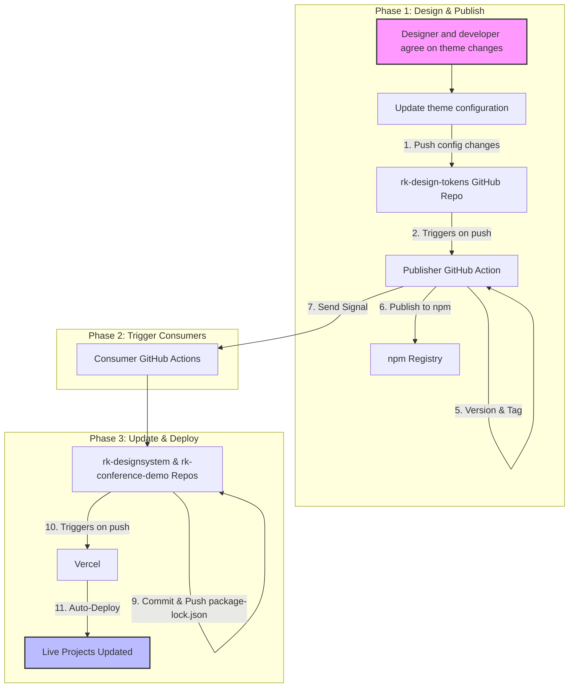

# Røde Kors Design Tokens

> [!IMPORTANT]
> **This repository has moved to Azure DevOps and is archived here.**
> Code, pull requests and releases now live in
> [RedCrossNorway / DesignPlatform / design-tokens](https://dev.azure.com/RedCrossNorway/DesignPlatform/_git/design-tokens).
> The package is published as
> [`@norwegianredcross/design-tokens`](https://www.npmjs.com/package/@norwegianredcross/design-tokens)
> (formerly `rk-design-tokens`). The theme CSS is on npm's CDN:
> `https://cdn.jsdelivr.net/npm/@norwegianredcross/design-tokens/design-tokens-build/theme.css`.
> Nothing here is updated any more.

## Source of truth and building

The authoritative design is [Figma Components — Main](https://www.figma.com/design/zCMN259qfgUaA5zTAXq5hQ/02.-Components), read through Figma MCP and revalidated on 2026-10-10.
`test/fixtures/figma-main.json` contains all 910 variables from its six local
collections. The previous branch and Desktop export are historical references.

`design-tokens/` contains the Digdir sources. Generated files are only written by
the build, never edited by hand:

```sh
npm ci
npm run build
npm test
```

The build uses the pinned official Digdir 1.18.0 `tokens build` command. Its output
is in `design-tokens-build/digdir/`. The public theme entry points import it plus
`figma.css`, which preserves Figma's explicit size scales. Bootstrap, shadcn,
metadata and legacy `dist/` entries are rebuilt from the compiled tokens.

To import a newly reviewed Main MCP snapshot into the source files:

```sh
node scripts/import-figma-main.js
npm run build
npm test
```

Review the snapshot before importing. The importer updates colors, aliases,
border widths and typography modes. Spacing, radii and text-style metrics are
verified against Main by tests; review those sources if a future snapshot changes
them. Do not run `tokens create` during a normal build: it bootstraps sources and
cannot preserve every Figma alias or contextual mode. The config records palette
values but is not a replacement for the complete checked-in token sources.

Main's color contexts map to CSS selectors as follows:

| Figma Main mode | `data-color` |
| --- | --- |
| Hoved · beige (default) | `hoved-beige` |
| Hoved · rosa | `hoved-rosa` |
| Hoved · mint | `hoved-mint` |
| Hoved · lyseblå | `hoved-lysebla` |
| Hoved Nøytral | `hoved-neutral` |
| Nøytral | `neutral` |
| Danger / Warning / Success / Info | `danger` / `warning` / `success` / `info` |

These are contextual aliases, not interchangeable palette names. For example,
Hoved · rosa changes the tinted background while retaining rust action colors.
The underlying palettes remain available: `red-cta`, `rust-main`,
`secondary-color-warm-beige`, `secondary-color-orange`, `secondary-color-pink`,
`additional-color-ocean`, and `additional-color-jungle`. Existing
`primary-color-red` and `secondary-color-rust` names remain compatibility aliases
for `red-cta` and `rust-main`.

Both themes use Source Sans 3 for `primary`, `secondary`, and `header` typography
modes, exactly as Main's variables specify. Main's seven saved heading text styles
still name Source Serif 4; that inconsistency is recorded in the snapshot. The
package follows the variable tokens and the explicit Source Sans 3 requirement.
Named text-style sizes, weights, line heights and tracking match Main.

Tests resolve every semantic color and all ten contextual color modes through the
compiled CSS for both themes and both schemes. They also check the three size
scales, radii, borders, opacity, typography, compatibility aliases and entry points.

Import `rk-designsystem/styles` for React component CSS and packaged fonts.
Tokens alone do not establish complete component or layout parity. The component
measurements in `audit/after/` refer to the previous branch; Main token validation
is recorded separately in `audit/main/`.

---

## How to Use These Tokens

This package can be used in different ways depending on the component library you are working with.

---

### Using with Røde Kors Designsystem (`@digdir/designsystemet`)

This is the primary way to use the tokens for official Røde Kors projects built with the React component library.

#### 1. Installation

You'll need three packages: the component library (`rk-designsystem`), the base styles from Digdir, and this theme package (`rk-design-tokens`).

```bash
npm install rk-designsystem @digdir/designsystemet-css rk-design-tokens
```

#### 2. Import CSS

In your application's root layout file (e.g., `layout.tsx`), import the component package's stylesheet.

**TypeScript**

```typescript
// src/app/layout.tsx (or equivalent)

import 'rk-designsystem/styles'; // Digdir + theme + Røde Kors component styles + fonts

export default function RootLayout({ children }) {
  return (
    <html lang="no">
      <body>{children}</body>
    </html>
  );
}
```

### Using with Bootstrap (Sass)

This package provides a dedicated Sass file to fully theme the Bootstrap framework, including support for light and dark modes.

#### 1. Installation

In addition to this package, your project must also have `bootstrap` and `sass` installed.

```bash
npm install bootstrap sass
```

#### 2. Import Sass Theme

In your project's main Sass file (e.g., `globals.scss`), import the Røde Kors theme file before the main Bootstrap library.

```scss
// 1. Import the Røde Kors theme file for Bootstrap.
// This contains all the necessary variable overrides.
@import "rk-design-tokens/design-tokens-build/bootstrap-theme.scss";

// 2. Import the main Bootstrap library.
// Bootstrap will now compile using your custom theme.
@import "bootstrap/scss/bootstrap";
```

#### 3. Enable Theme Switching

To switch between light and dark modes, apply the `data-bs-theme` attribute to a parent element (like `<html>`). You can toggle this value with JavaScript.

**TypeScript**

```typescript
// Example in a Next.js layout.tsx

// Sets the default theme to "light"
export default function RootLayout({ children }) {
  return (
    <html lang="no" data-bs-theme="light">
      <body>{children}</body>
    </html>
  );
}
```

### Using with shadcn/ui (Tailwind + shadcn)

This section explains two common ways to use `rk-design-tokens` together with `shadcn/ui` (which uses Tailwind CSS and Radix): (A) import the generated CSS variables directly, or (B) map tokens into Tailwind’s theme so utility classes can reference them.

Pick the approach that fits your project.

#### A) Import `rk-design-tokens` CSS (fast, minimal)

1.  **Installation**

    ```bash
    npm install rk-design-tokens
    ```

2.  Import token CSS in your global stylesheet or root layout before your app styles so the CSS variables and theme overrides are available to shadcn components.

    **Example (Next.js app directory — `src/app/layout.tsx`):**

    ```typescript
    // src/app/layout.tsx (or equivalent)

    import 'rk-design-tokens/design-tokens-build/shadcn-theme.css'; // import tokens first
    import './globals.css'; // your Tailwind/shadcn global CSS

    export default function RootLayout({ children }) {
      return (
        <html lang="no">
          <body>{children}</body>
        </html>
      );
    }
    ```

3.  **Usage**

    *   shadcn components will pick up colors and variables defined in the imported CSS (via CSS variables). Use Tailwind utility classes as usual and override styles with the CSS variables if needed (see approach B for mapping into Tailwind utilities).

    *   For theme switching (light/dark), the token CSS supports data attributes — apply e.g. `<html data-theme="light">` or `<html data-theme="dark">` depending on the token build (or use `data-bs-theme` if you are using that approach). Confirm the token CSS file you imported supports the attribute you toggle.

#### B) Map tokens into Tailwind (recommended for full Tailwind utility support)

1.  **Installation**

    ```bash
    npm install rk-design-tokens
    ```

2.  Import tokens CSS (to expose CSS variables) and configure Tailwind to read CSS variables for colors and other tokens.

    *   Import token CSS in your global CSS so the variables exist at runtime:

        ```css
        /* src/styles/globals.css */
        @import "rk-design-tokens/design-tokens-build/shadcn-theme.css";
        
        /* Tailwind base */
        @tailwind base;
        @tailwind components;
        @tailwind utilities;
        ```

    *   In `tailwind.config.js` map your theme values to the CSS variables exported by the tokens. Many token sets expose variables like `--rk-color-primary`, `--rk-foreground`, etc. Use the `rgb/var` pattern to preserve Tailwind alpha utilities:

        ```javascript
        // tailwind.config.js
        module.exports = {
          content: [
            './src/**/*.{js,ts,jsx,tsx}',
            // shadcn/ui components locations if applicable
          ],
          theme: {
            extend: {
              colors: {
                primary: {
                  DEFAULT: 'rgb(var(--rk-color-primary) / <alpha-value>)',
                  foreground: 'rgb(var(--rk-color-on-primary) / <alpha-value>)',
                },
                background: 'rgb(var(--rk-color-background) / <alpha-value>)',
                // add other tokens you need
              },
              // Map typography, radius, spacing similarly if tokens expose variables
              borderRadius: {
                lg: 'var(--rk-radius-lg)',
              },
            },
          },
          plugins: [
            require('@tailwindcss/forms'),
            // other plugins
          ],
        };
        ```

3.  **Usage**

    *   Now standard Tailwind classes work with your design tokens:
        *   `bg-primary`, `text-primary-foreground`, `ring-primary/50`, etc.

    *   shadcn components (which are Tailwind-based) will use these variables when you apply Tailwind utilities or when you customize component props/classes.

#### Notes and tips

*   **Verify variable names:** open the imported token CSS to confirm exact CSS variable names (e.g., `--rk-color-primary` or `--rk-token-color-primary`). Adjust `tailwind.config.js` accordingly.

*   **Dark mode:** If your token CSS supports data-attribute theme switching (e.g., `data-theme` or `data-bs-theme`), you can toggle the attribute on `<html>` or a parent to switch themes. If you use Tailwind’s class-based dark mode, combine approaches by ensuring the token CSS includes both light/dark variable definitions and toggling the same attribute/class you use for dark in Tailwind. Example:
    *   Use attribute: `<html data-theme="dark">` and ensure token CSS maps the variables for that attribute.
    *   Or import a token CSS that exposes dark variables under `.dark` (less common).

*   **Server-side rendering:** For Next.js, ensure the token CSS import is included in your `app/layout` so variables are present on first paint to avoid FOUC.

*   **Customizing shadcn components:** You can pass Tailwind classes that reference mapped token colors or create component-level CSS that uses the token CSS variables directly (e.g., `color: var(--rk-color-primary)`).

#### Example minimal Next.js + shadcn setup

1.  **Install packages:**

    ```bash
    npm install rk-design-tokens tailwindcss postcss autoprefixer
    ```

2.  Configure Tailwind as shown above and import token CSS in `globals`.

3.  Use shadcn components and apply classes like `bg-primary text-primary-foreground`.

This gives you flexibility: use the token CSS directly for global theming (approach A), or map tokens into Tailwind for rich utility support and smooth integration with shadcn (approach B). Choose whichever fits your workflow best.

### End-to-End Design Token Automation Workflow

#### Brief Explanation

This workflow builds, versions, and publishes the package when theme configuration
changes are pushed to main. Designers and developers agree on the changes, update
the configuration, and pull the generated tokens into Figma through Tokens Studio.
After publishing, the workflow signals the consuming projects to update.

#### Flowchart



#### The Process in Detail

##### Phase 1: A Designer Makes a Change (The "Publisher")

This phase occurs within the `rk-design-tokens` repository.

*   **Agree on design changes:** A designer and developer identify the theme changes.
*   **Update sources:** Import the reviewed Main snapshot into `design-tokens/`, update the configuration and adapter as needed, then run the official build and tests. Generated files must not be edited by hand.
*   **Trigger the Publisher Workflow:** This push instantly triggers the GitHub Action defined in `.github/workflows/publish.yml`.
*   **Build & Commit Artifacts:** The workflow runs `npm run build` to generate CSS from the JSON files and commits the results.
*   **Versioning & Release:** Before submitting a reproducible, checked-in build, run `npm version patch --no-git-tag-version` and commit `package.json` and `package-lock.json` with the sources and generated output. The workflow publishes that unpublished version even when rebuilding produces no diff, and creates its tag. If CI itself produces changed output for an already published version, it bumps the patch version. Registry/network errors stop the release.
*   **Publish to npm:** Finally, the workflow publishes the new version of the package to the npm registry.

##### Phase 2: Notifying the Applications (The "Signal")

*   **Send a Dispatch Signal:** After a successful publish, the workflow sends a `repository_dispatch` signal to consumer projects like `rk-designsystem` to notify them of the new version.

##### Phase 3: Automatic Update and Redeployment (The "Consumers")

This phase runs in parallel for consumer projects.

*   **Trigger the Consumer Workflow:** The dispatch signal starts an "Update" workflow in the consumer projects.
*   **Update Dependencies:** The workflow runs `npm update rk-design-tokens` to fetch the latest version.
*   **Commit & Push the Update:** The workflow commits the updated `package-lock.json` file.
*   **Vercel Auto-Deploys:** Vercel's Git integration detects the new commit and automatically starts a new deployment.

Publishing tokens signals the configured downstream repositories. Their own workflows and release checks determine when applications receive the update; publishing tokens does not prove a production deployment or component parity.
